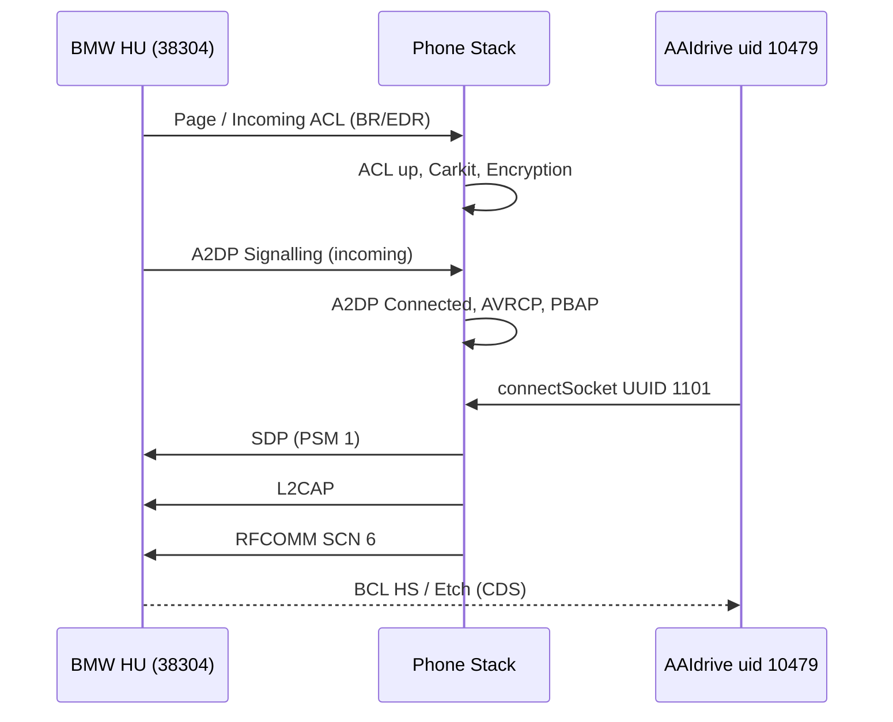

# BMW Bluetooth-Verbindungsanalyse — 15.11.2026 (3 Läufe)

## Quelldateien

| Lauf | Datei (Workspace) | Zeilen | Zeitfenster |
|------|-------------------|--------|-------------|
| A | `docs/bluetooth_20261115_173553_27305.log` | 42 835 | 17:35:53 – 17:36:35 |
| B | `docs/bluetooth_20261115_174331_31413.log` | 38 295 | 17:43:31 – 17:44:14 |
| C | `docs/bluetooth_20261115_174417_32229.log` | 2 159 | 17:44:16 – 17:44:17 (+ Rest Stack-Leerlauf) |

**Hinweis:** Die vom Upload genannten Pfade unter `/home/ubuntu/.cursor/projects/workspace/uploads/` waren in dieser Umgebung nicht vorhanden; die inhaltlich passenden Logs liegen im Repo unter `docs/` (ohne Suffix `_7a58` / `_ee8a` / `_537d`).

---

## Log-Format und Auswertung

**Typ:** Android-Bluetooth-Stack-Textlog (Oppo/OnePlus, MTK), kein Wireshark-Text und kein reines btsnoop.

**Struktur pro Zeile:**

```text
[<Log-Uptime>][<Monat-Tag HH:MM:SS.mmm>][<LEVEL>][<PID>] [<TAG>] <Nachricht>
```

**Zeile 1:** Metadaten (`Current process ID`, `log file folder = /data/misc/bluetooth/logs/`).

**Auswertung:** Regex-Suche auf BMW-Merkmale (`BMW 38304`, MAC `…:e1:b5`), Zeitstempel-Spalte 2 als Referenz, Meilenstein-Extraktion per Python-Skript; BCL-Inhalte über `oplus_send_data_to_app_dump` (max. 32 Byte Hex im Log — siehe bestehende Projekt-Dokumentation).

**Gerät:** Headunit **BMW 38304**, BR/EDR, CoD `0x340408` (Car Kit), Hersteller `0x000D` (Texas Instruments), bereits **gepairt** (`Connected to known device`, `bond_type:BOND_TYPE_PERSISTENT` in Lauf B).

**Android Auto / IAP:** In diesen drei Logs **keine** Treffer auf Android Auto, Gearhead, IAP/iAP2 o. Ä. AAIdrive nutzt **SPP UUID `0x1101`** (RFCOMM), nicht den USB/WLAN-Android-Auto-Stack.

---

## Kurzfazit (übergreifend)

1. **Verbindungsinitiator ist die HU**, nicht das Telefon: `OnIncomingClassicConnection` / eingehende ACL unmittelbar vor `btm_sec_connected`.
2. **Kein erneutes Pairing** — Wiederverbindung über Bond-Cache.
3. **Klassische Profil-Reihenfolge nach ACL:** Verschlüsselung (~0,5 s) → HU-initiiertes A2DP (incoming) → AVRCP/PBAP-Stapelarbeit → **~5 s später** AAIdrive (`uid 10479`) mit SDP → L2CAP → RFCOMM **SCN 6**.
4. **„AAIdrive grün“ (Proxy):** Erste große Etch/CDS-Nutzlast (`DEADBEEF`, 667 Byte) ca. **+9,7–10,1 s** nach ACL; sinnvoller Log-Marker, nicht exakt die UI-Zeit.
5. **Lauf C unbrauchbar** für BMW: Stack erreicht nur `BLE_ON`, kein klassisches `AdapterState ON`, keine BMW-ACL.

---

## Zeitachse Lauf A (`173553`)

| Ereignis | Zeit (Wall) | Δ seit ACL |
|----------|-------------|------------|
| Adapter `ON` | 17:35:53.534 | — |
| **Störung:** eingehende ACL zu anderem Gerät (`…:b7:21`) + HFP AG | 17:36:08 | — |
| **BMW eingehend** (`on_incoming_connection`, CoD 340-4-08) | 17:36:22.082 | −0,02 s |
| ACL HCI (`btm_sec_connected`, BMW) | 17:36:22.105 | **0** |
| Verschlüsselung (`encryption_change_cb`) | 17:36:22.560 | +0,46 s |
| A2DP `Connected` | 17:36:24.830 | +2,73 s |
| A2DP Stream Start | 17:36:27.570 | +5,46 s |
| AAIdrive `connectSocket` → UUID 1101, **uid 10479** | 17:36:27.424 | +5,32 s |
| SDP → L2CAP PSM 1 → **RFCOMM SCN 6** offen | 17:36:27.545 | +5,44 s |
| Erste BCL-RX an App (16 B, HS-ähnlich) | 17:36:27.636 | +5,53 s |
| Etch/CDS-Fragment (667 B, `DEADBEEF`) | 17:36:31.846 | +9,74 s |
| Bluetooth `TURNING_OFF` | 17:36:35.563 | +13,46 s |

**BT-Ein → BMW-ACL:** 28,6 s (verlängert durch parallele Verbindung zu `b7:21` ab +14,5 s).

**HFP zum BMW:** Kein `BTA_AG_OPEN` / HFP-SCB für `e1:b5` in diesem Log; HFP-Aktivität bezieht sich auf das andere Gerät.

**Anomalie Lauf A:** Zweite BR/EDR-ACL während der HU-Wartezeit; RFCOMM zu `b7:21` (uid 10464, fremde App) läuft parallel bis BT aus. Kann Page-/Profil-Ressourcen binden.

---

## Zeitachse Lauf B (`174331`)

| Ereignis | Zeit | Δ seit ACL |
|----------|------|------------|
| Adapter `ON` | 17:43:31.432 | — |
| BMW eingehend | 17:43:45.570 | −0,02 s |
| ACL HCI | 17:43:45.592 | **0** |
| A2DP `Connected` | 17:43:47.976 | +2,38 s |
| AAIdrive `connectSocket` (10479) | 17:43:50.601 | +5,01 s |
| RFCOMM SCN 6 offen | 17:43:51.022 | +5,43 s |
| BCL erste RX (16 B) | 17:43:51.082 | +5,49 s |
| Etch/CDS 667 B | 17:43:55.697 | +10,11 s |
| BMW Trennung (`HCI_ERR_PEER_USER`) | 17:44:14.112 | +28,52 s |

**BT-Ein → BMW-ACL:** 14,2 s (deutlich kürzer als Lauf A, kein konkurrierendes Gerät in dem Fenster).

**Profil-Parallele:** Gleiches Muster — HU treibt A2DP/AVRCP/PBAP; App-seitig AAIdrive erst nach stabilem ACL+A2DP.

**SCN10-Failover:** In beiden vollständigen Läufen **nicht** beobachtet (nur SCN 6).

---

## Zeitachse Lauf C (`174417`)

| Ereignis | Zeit |
|----------|------|
| Stack-Neustart (PID 32229) | 17:44:16.757 |
| `BLE_TURNING_ON` | 17:44:16.989 |
| `BLE_ON` (Ende sichtbarer Hochlauf) | 17:44:17.252 |
| **`AdapterState ON` (BR/EDR)** | **fehlt** |
| BMW / ACL / AAIdrive | **keine** |

Interpretation: Dritter Zyklus wurde abgebrochen, bevor Classic Bluetooth vollständig aktiv war — typisch, wenn BT zu früh wieder ausgeschaltet wird oder der Log-Capture nur den Stack-Start erwischt. Spätere Zeilen im File stammen aus anderem Prozess-/Leerlauf-Kontext (`dumpsys`, PID 00887) ohne BMW-Bezug.

---

## Schichtfolge (Discovery-Reihenfolge)



**Pairing/Bonding:** Nur Laden gebondeter Geräte beim Stack-Start; bei BMW sofort `known device`, `pairing_state:IDLE`.

**RFCOMM / BCL (AAIdrive):** Erster App-RX-Payload typisch `00040000000000080005000E00004000` (HS v5 / Buffer 0x4000); später `DEADBEEF`-Etch — konsistent mit Projekt-Referenz `FIELD_AAIDRIVE_BTLOG_20261115.md`.

---

## Quervergleich A vs. B

| Metrik | Lauf A | Lauf B |
|--------|--------|--------|
| BT ON → ACL | 28,6 s | 14,2 s |
| ACL → A2DP connected | 2,73 s | 2,38 s |
| ACL → RFCOMM SCN6 | 5,44 s | 5,43 s |
| ACL → Etch 667 B | 9,74 s | 10,11 s |
| Paralleles Fremd-ACL | ja (`b7:21`) | nein |
| SCN10-Failover | nein | nein |
| Explizite Disconnect-Zeile | nein (BT aus) | ja (HU, 0x13) |

Die **AAIdrive-Pfad-Timings** (5 s bis SPP, ~10 s bis Etch) sind zwischen A und B **stabil**; die Streuung liegt vor allem in **HU-Page-Verzögerung nach BT-Ein**.

---

## Hypothesen: Wann „startet“ die Verbindung?

1. **Logisch:** Sobald die HU den Phone paget (`OnIncomingClassicConnection`). Das passiert **nicht** beim BT-Einschalten am Phone, sondern wenn die HU bereit ist (14–29 s in diesen Läufen).
2. **Für „Telefon verbunden“ (klassisch):** ACL + Verschlüsselung (~0,5 s).
3. **Für Medien/Telefonie-Profile:** A2DP connected ~+2,4–2,7 s; HFP für BMW in diesen Captures **nicht** separat sichtbar (evtl. auf HU-Seite anders geloggt oder nicht genutzt).
4. **Für AAIdrive grün:** App-Socket + BCL-Handshake **~+5 s**; substanzielle CDS-Daten **~+10 s** nach ACL — UI „grün“ vermutlich dazwischen, bestätigung nur am Gerät.
5. **Oppo-Interop:** `OplusDisableAutoConnect` matcht Name `****38304` → Auto-Reconnect-Pfad kann beeinflusst sein; trotzdem HU-initiiertes Incoming.

---

## Empfehlungen für weitere Captures

- **btsnoop_hci** parallel zu diesem Textlog (beide Richtungen, RFCOMM-Filter aus), um Phone→HU in der „stillen“ Phase zu sehen.
- Beim Messen **andere BT-Geräte trennen** (Lauf A).
- Lauf C: mindestens bis `AdapterState ON` und BMW-ACL warten.
- Marker setzen: ACL-Zeit, erste `10479`/`connectSocket`, erste `DEADBEEF`-667 B, UI-Grün manuell notieren.

---

## Verwandte Projekt-Dokumente

- `docs/analysis/ONEPLUS_BT_FORENSIC_20261115.md` (Gesamtforensik 8 Logs)
- `docs/analysis/oneplus-bt-forensic-stats-20261115.json`
- `docs/evidence/FIELD_AAIDRIVE_BTLOG_20261115.md`
- `docs/evidence/FIELD_VS_LAB_INSIGHTS_20261115.md`
- `docs/bmw_aaidrive_field_reduced_20261114.txt`