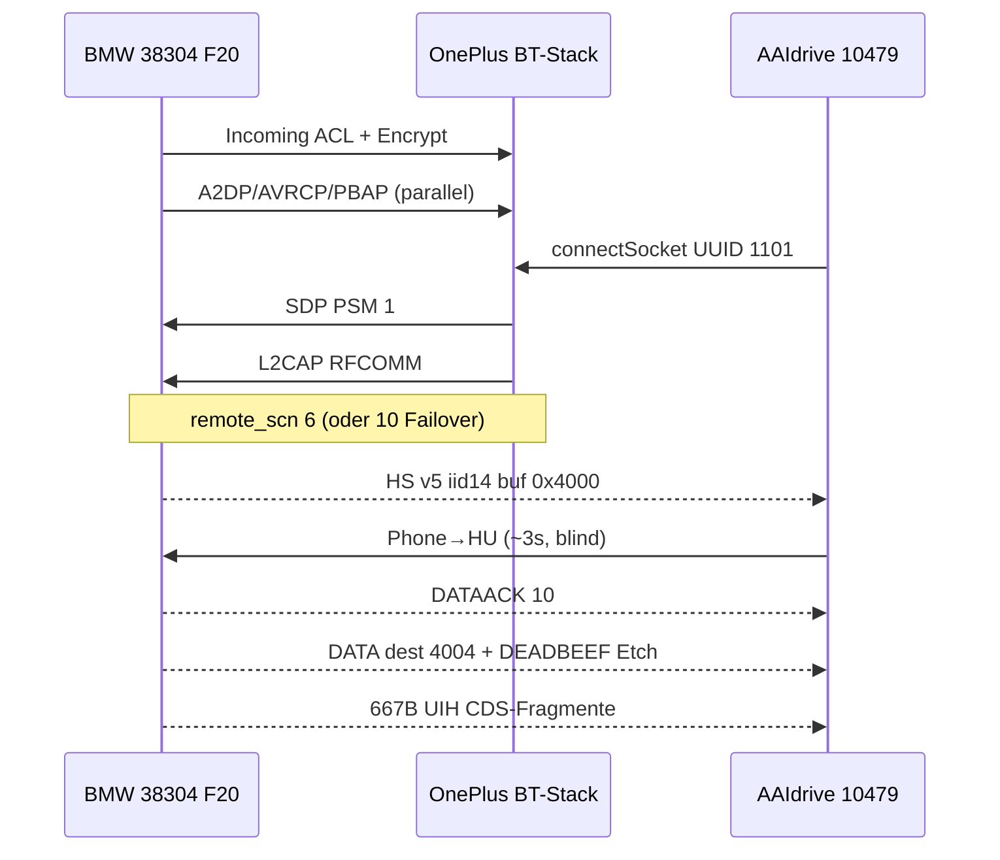

# Forensische Gesamtanalyse — OnePlus 12 ↔ BMW F20 NBT Evo „BMW 38304“ (15.11.2026)

**Peer HU:** `d4:36:39:cf:e1:b5` · **AAIdrive/MyBMW:** `uid 10479` · **SPP:** UUID `0x1101`  
**Auswertung:** vereinheitlichte Analyse aller acht `bluetooth_20261115_*.log` im Repo (`docs/`), Erweiterung von `docs/analysis/BMW_BT_CONNECTION_ANALYSIS_20261115.md` und Feld-Dokumenten unter `docs/evidence/`.

Epistemische Stufen in diesem Bericht: **FIELD FACT** · **STRONG** · **INFERENCE** · **HYPOTHESIS** · **UNKNOWN** · **REJECTED**

---

## 1. Auftrag und Fragestellung

Forensische Gesamtschau für Martin (Bluetooth Analyzer Project): Phone→HU vor/nach **OPEN dest=4004 (0x0FA4)**, **CONTENT-GATE**, **KNOCK 56 B**, **SCN6/SCN10**, **DATAACK↔DATA**, SAS/Auth, und ob **Oppo-Textlogs** fehlendes **HCI** (16-Byte-CFA-Exporte) ersetzen können.

## 2. Korpus

| ID | Datei | Rolle |
|----|-------|--------|
| S-A | `bluetooth_20261115_102033_30998.log` | Vormittag: SCN6 **DM**, Failover **SCN10** (2 Versuche) |
| S-B | `bluetooth_20261115_102058_28027.log` | Vormittag: **Goldener Pfad** SCN6 → CDS/Etch |
| S-C | `bluetooth_20261115_102217_29993.log` | BT-Neustart, **kein** BMW-BCL |
| E-520 | `bluetooth_20261115_173520_25902.log` | Abend: vollständige BMW-Session |
| E-553 | `bluetooth_20261115_173553_27305.log` | Abend: BMW + paralleles Fremd-ACL `b7:21` |
| E-637 | `bluetooth_20261115_173637_28667.log` | Abend: längere AAIdrive-Capture |
| E-431 | `bluetooth_20261115_174331_31413.log` | Abend: Referenzlauf (Disconnect HU) |
| E-417 | `bluetooth_20261115_174417_32229.log` | Abgebrochen: nur `BLE_ON`, **kein** Classic ON |

Weitere gescannte Artefakte: `docs/evidence/FIELD_AAIDRIVE_BTLOG_20261115.md`, `FIELD_AAIDRIVE_BTLOG_20261115_decode.json`, `LAB_SILENT_HU_INIT_KNOCK_20261115.md`, `FIELD_VS_LAB_INSIGHTS_20261115.md`, 15× `bluetooth_20261114_*.log`, `BT_HCI_2026_1114_104405.cfa` (16 B, leer). Upload-Pfad `/home/ubuntu/.cursor/projects/workspace/uploads/` **nicht vorhanden** — inhaltlich gleiche Logs unter `/workspace/docs/`.

## 3. Methodik

- Regex-/Python-Parsing der Zeilenstruktur `[uptime][MM-DD HH:MM:SS.mmm][LEVEL][PID] [TAG] …`
- Wall-Clock-Spalte 2 als Zeitachse; Meilensteine ACL / SDP / RFCOMM / `oplus_send_data_to_app_dump` / `PORT_WriteDataCO`
- Volle Hex nur wenn im Log **ohne** `...` gekappt (Oppo **`data_hex` max. 32 B**)
- Strikte Trennung Profil-Stack (A2DP/HFP/PBAP) vs. AAIdrive `10479`/`scn=6|10`

## 4. Ausgangsfakten (übernommen, nicht widerlegt)

| Aussage | Stufe |
|---------|-------|
| HU initiiert eingehende BR/EDR-ACL (Page), Phone ist nicht Initiator | **FIELD FACT** |
| Bond persistent, kein erneutes Pairing in 15.11.-Captures | **FIELD FACT** |
| MyBMW/AAIdrive nutzt SPP `0x1101`, nicht Android Auto USB | **FIELD FACT** |
| HS HU→Phone: `version=5`, `instance_id=14`, `buffer=0x4000` | **FIELD FACT** |
| F20 BCL-Server SCN6 in Lab/Hold reproduzierbar | **FIELD FACT** (cross-ref Lab) |
| `DATAACK count = 8 + payload_len` für **beobachtete** quittierte Frames | **STRONG** / Bimmer-INFERENCE |
| KNOCK 56 B → **kein** DATAACK 56 in Analyzer-Holds | **FIELD FACT** (M48) |

## 5. Log-Format Oppo/OnePlus

**FIELD FACT:** Android-Bluetooth-Stack-Textlog (MTK/Oplus), kein Wireshark-Export.

```text
[uptime][11-15 HH:MM:SS.mmm][LEVEL][PID] [TAG] message
```

RFCOMM-RX an Apps: `oplus_send_data_to_app_dump` mit `len=` und `data_hex=` (typisch **32 Hex-Zeichen** = 16 B sichtbar, bei längeren UIH oft `...`).

Phone-TX: `PORT_WriteDataCO: N bytes` + unmittelbares `rfc_port_sm_opened … scn:6` — **kein** Hex auf Phone→HU-Payload in diesen Logs.

## 6. HCI / btsnoop / CFA

**FIELD FACT (15.11., alle untersuchten Logs):**

```text
is_oplus_btsnoop_enabled = 0
set_is_hci_log_enabled: update to false!
```

CsLog-Pfad `BT_HCI_2026_1115_*.cfa.curf` wird angelegt, HCI-Inhalt in den **Textlogs nicht rekonstruierbar**. Referenz `BT_HCI_2026_1114_104405.cfa`: **16 Byte** BTSnoop-Header, keine Nutzdaten.

**INFERENCE:** Parallele `btsnoop_hci_*.cfa` auf dem Gerät können existieren, werden hier aber nicht exportiert/geliefert.

## 7. Kernfrage: Können `bluetooth_*.log` fehlendes HCI ersetzen?

| Dimension | Ersatzfähigkeit | Stufe |
|-----------|-----------------|-------|
| Zeitstempel ACL, Encryption, A2DP connected, `connectSocket 1101` | **Ja** — Stack-Events | **FIELD FACT** |
| SDP-Ergebnis „Channel 6 vs 10“ | **Teilweise** — siehe §10 (Post-SDP `remote_scn`, nicht Roh-SDP-PDU) | **STRONG** |
| RFCOMM-SCN, DLCI, L2CAP-CID (Logger-Zeilen) | **Ja** — begrenzt auf Metadaten | **FIELD FACT** |
| HU→Phone BCL (DATAACK, Etch, 667 B UIH) | **Teilweise** — ~1,65 % Bytes in S-B (decode.json) | **FIELD FACT** |
| Phone→HU vor erstem DATAACK (≈3 s) | **Nein** — nur Längen `PORT_WriteDataCO` (4/10/56/…) | **FIELD FACT** |
| Vollständige 667 B / SAS-Challenge | **Nein** | **UNKNOWN** ohne btsnoop |
| Link-Layer-RTT, ACL-Umbrella, RFCOMM-UIH-Rohbytes bidirektional | **Nein** — nur L2CAP-Sendelogs, kein ACL-Sniff | **REJECTED** als HCI-Ersatz |

**Kurzantwort:** Textlogs ersetzen **HCI nicht**; sie liefern eine **zeitlich hochauflösende Transportschicht-Karte** und eine **verzerrte BCL-Sondenansicht** (HU→Phone überdump, Phone→HU blind).

## 8. Session-Matrix (Meilensteine)

Zeiten Wall-Clock; `Δ` relativ zu BMW-ACL wo vorhanden.

### 8.1 S-B (Golden, SCN6)

| Ereignis | Zeit | Δ ACL |
|----------|------|-------|
| ACL | 10:21:20.116 | 0 |
| `connectSocket` 1101 uid 10479 | 10:21:25.087 | +4,97 s |
| SDP→`remote_scn:6` | 10:21:25.290 | +5,17 s |
| RFCOMM up scn 6 | 10:21:25.427 | +5,31 s |
| HS RX 16 B | 10:21:28.459 | +8,34 s |
| `PORT_WriteDataCO: 56` | 10:21:31.446 | +11,33 s |
| DATAACK **10** (0x0A) | 10:21:31.471 | +11,36 s |
| erstes DATA→4004+DEADBEEF (52 B dump) | 10:21:31.972 | +11,86 s |
| erstes UIH **667** | 10:21:34.208 | +14,09 s |

**Silent window HS→DATAACK10:** **3,012 s** (**FIELD FACT**).

### 8.2 S-A (SCN6 DM → SCN10)

| Ereignis | Zeit |
|----------|------|
| `connectSocket` → SDP → `remote_scn:6` | 10:20:35.279–.444 |
| **RFC_PORT_EVENT_DM** / `Start failed[12]` | 10:20:35.584 |
| `remote_scn:10` Versuch 1 | 10:20:37.149 → cleanup 10:20:45.321 (**kein** HS-Dump) |
| `remote_scn:10` Versuch 2 | 10:20:48.973 → HS 10:20:49.112 → Etch → close 10:20:56 |

### 8.3 Abend-Läufe E-520 … E-431 (SCN6 nur)

Stabile Muster (±50 ms): ACL → ~5 s → RFCOMM SCN6 → HS → **~3,0 s** → DATAACK 10 → DATA/Etch → 667 B (~+9–10 s nach ACL). Details: `docs/analysis/BMW_BT_CONNECTION_ANALYSIS_20261115.md`.

### 8.4 Negative Sessions

- **S-C / E-417:** kein BMW / kein AdapterState Classic — **NOT OBSERVED**
- **E-553:** paralleles ACL `78:85:f4:f7:b7:21` während HU-Page — **FIELD FACT** (Störpotential)

## 9. Transportschicht (vereinheitlicht)



**FIELD FACT:** Initiator der ACL ist die HU. AAIdrive startet **nach** stabilem ACL (+ typisch A2DP connected).

## 10. SCN6 vs SCN10 — nur SDP/RFCOMM-Logs (Rohdaten zuerst)

### 10.1 RFCOMM-Client (nach SDP), UUID 0x1101

**SCN6 — S-B (Erfolg):**

```text
[11-15 10:21:25.290] BTA_JvRfcommConnect: remote_scn:6, peer_bd_addr:xx:xx:xx:xx:e1:b5, rfcomm_slot_id:9
[11-15 10:21:25.290] RFCOMM_CreateConnectionWithSecurity: bd_addr=xx:xx:xx:xx:e1:b5, scn=6, is_server=false, mtu=990, uuid=0x1101, dlci=12
[11-15 10:21:25.427] on_cli_rfc_connect: … scn: 6, app_uid: 10479, id: 9
```

**SCN6 — S-A (DM):**

```text
[11-15 10:20:35.444] BTA_JvRfcommConnect: remote_scn:6, … rfcomm_slot_id:79
[11-15 10:20:35.584] rfc_port_sm_execute: … event:RFC_PORT_EVENT_DM
[11-15 10:20:35.586] port_rfc_closed: … reason=Start failed[12], UUID=0x1101
```

**SCN10 — S-A (Failover, gleiches UUID):**

```text
[11-15 10:20:37.149] BTA_JvRfcommConnect: remote_scn:10, … rfcomm_slot_id:80
[11-15 10:20:37.149] RFCOMM_CreateConnectionWithSecurity: … scn=10, … uuid=0x1101, dlci=21
[11-15 10:20:49.112] oplus_send_data_to_app … scn=10 len=16 data_hex=00040000000000080005000E00004000
```

**Abend — nur SCN6:**

```text
remote_scn:6 in E-520, E-553, E-637, E-431 — NOT OBSERVED: remote_scn:10
```

### 10.2 SDP-Rohexport

**NOT OBSERVED** in allen 15.11.-Logs: dekodierte SDP-Attribute-PDU mit `ProtocolDescriptorList` Channel-Nummer als Hex-String. Sichtbar sind nur:

- `BTA_JvStartDiscovery` / `sdp_conn_originate` für `e1:b5`
- unmittelbar danach `BTA_JvRfcommConnect: remote_scn:N`

| Schluss | Stufe |
|---------|-------|
| HU exponiert mindestens **zwei** RFCOMM-Kanäle für `0x1101` (6 und 10) | **FIELD FACT** (S-A) |
| Golden Path und alle Abend-Sessions nutzen **SCN6** | **FIELD FACT** |
| SCN10 trägt nach SCN6-DM denselben HS/Etch-Typ | **FIELD FACT** (S-A Versuch 2) |
| Semantik „zweiter gleichwertiger BCL-Endpunkt“ in SDP | **UNKNOWN** |

## 11. BCL-Handshake und DATAACK-Modell

### 11.1 HS (HU→Phone), volle Log-Hex

```text
00040000000000080005000E00004000
```

16 B = OPEN/HS-Shape v5 / iid 14 / 0x4000 (**FIELD FACT**, konsistent alle Sessions).

### 11.2 Erstes HU-DATAACK

```text
00060000000000040000000A
```

`count=10` → **8+2** = SELECTPROTO 2 B (**STRONG**, Modell M31).

### 11.3 DATAACK-Histogramm (aus `…00040000XXXX` ACK-Zeilen, uid 10479)

| count (hex) | Bedeutung (Modell) | S-B Häufigkeit |
|-------------|-------------------|----------------|
| 0x0008 | 8+0 OPEN leer | beobachtet |
| 0x000A | 8+2 SELECTPROTO | erstes ACK |
| 0x000C | 8+4 WD | **REJECTED** als erklärte Phone-TX in Feld (WD=13371337 Lab) |
| 0x002C (44) | 8+36 kleine DATA | Opening-RPC |
| 0x0FA8 etc. | 8+groß | Fragment-ACKs |
| 0x0FA8 (4008) | 8+4000 | Max-Fragment |

**REJECTED:** monotonic flow counter; universelles ACK pro BCL-Kommando (**M48:** KNOCK ohne ACK56).

## 12. Phone→HU — Sequenz und stille ~3 s-Phase

### 12.1 Beobachtbar im Log (nach HS, vor DATAACK 10)

| Session | HS | DATAACK 10 | Δ | `PORT_WriteDataCO: 56` | `PORT_WriteDataCO: 4` im Fenster |
|---------|-----|------------|---|------------------------|----------------------------------|
| S-B | 28.459 | 31.471 | 3,012 s | 31.446 (1×) | mehrfach **vor** HS, nicht eindeutig INIT-Schleife im Fenster |
| E-431 | 51.082 | 54.060 | 2,978 s | 54.058 (1×) | NOT OBSERVED als dedizierte 4B-Serie |
| E-637 | 13.254 | 16.267 | 3,013 s | 16.231 (1×) | NOT OBSERVED |

**FIELD FACT:** Länge der stillen Phase (~3 s).  
**UNKNOWN:** Inhalt (INIT `12345678` / SP / KNOCK / OPEN 5001 / OPEN 4004) — **keine** `data_hex` für Phone→HU.

### 12.2 Reihenfolge relativ OPEN 4004 / 667 B (HU→Phone sichtbar)

**S-B (klarste Trennung):**

1. HS  
2. Phone-TX 56 B (RFCOMM, **ohne** Dump-Hex)  
3. DATAACK **10**  
4. DATA `dest=0x0FA4` + DEADBEEF (52 B im Dump, log `len=52`)  
5. **+236 ms** später weitere ACKs / Bursts  
6. **+2,24 s** nach Schritt 4: erstes **667** UIH  

**E-520 / E-553:** erstes sichtbares Etch bereits **667 B** mit eingebettetem `0FA414BA` — **INFERENCE:** OPEN/DATA und Bulk überlappt in einem UIH, nicht trennbar im 32-B-Keyhole.

### 12.3 CONTENT-GATE-Kandidaten

| Kandidat | Evidenz | Stufe |
|----------|---------|-------|
| Autorisierung **nach** BCL-Bootstrap, **bevor** HU bulk Etch sendet | ~3 s blind + Lab OPEN4004 ohne CDS | **STRONG** |
| Spezifisches fehlendes Phone→HU OPEN **4004** als Gate | nicht im Dump sichtbar; Lab sagt OPEN4004 allein reicht HU nicht für Etch | **INFERENCE** |
| SAS/`sas_certificate` String im Log | **NOT OBSERVED** | **UNKNOWN** |
| Erster HU DATA→4004 nach DATAACK10 | **FIELD FACT** (S-B) | **FIELD FACT** |

**Antwort Kernfrage 2:** Ein **inhaltliches** Content-Gate liegt **zwischen HS und erstem DATA→4004** (Phone→HU blind, ~3 s). **Nach** erstem DATA→4004 folgt bei Erfolg schnell **667 B-CDS** (143 ms–2,2 s je nach Session). **OPEN 4004** als Gate **allein** ist aus Logs nicht belegbar (Phone-TX unsichtbar); Lab bestätigt **Gate nach Transport-OPEN**.

## 13. KNOCK 56 B — Schichten

| Schicht | Was das Log zeigt | Stufe |
|---------|-------------------|-------|
| App (AAIdrive) | **NOT OBSERVED** (kein dump) | — |
| BTIF/JV | `bta_jv_port_data_co_cback … len=56` unmittelbar vor `PORT_WriteDataCO: 56 bytes` | **FIELD FACT** |
| RFCOMM | `rfc_port_sm_opened … scn:6` + `L2CA_DataWrite … Len: 60` | **FIELD FACT** |
| L2CAP/HCI | Keine Nutzlast-Hex | **NOT OBSERVED** |
| BCL/Etch decode | **NOT OBSERVED** | — |

**Lab-Quervergleich (STRONG INFERENCE):** Silent-HU-Capture enthält 56 B:

```text
deadbeef dead 01000000 2c0101
30 65 39 62 39 30 63 34 2d 63 62 65 31 2d 34 37 34 32 2d
38 32 38 33 2d 64 33 36 37 65 39 61 35 36 36 31 39
00 deadbeefbeef
```

(UUID `0e9b90c4-cbe1-4742-8283-d367e9a56619`) — **nicht** als `BclPacket cmd=8` belegt.

**Timing:** In allen Golden-Sessions genau **ein** `PORT_WriteDataCO: 56` zwischen HS und DATAACK10 (**FIELD FACT**). Ob Bytes = Lab-KNOCK-Envelope: **STRONG INFERENCE**, nicht **FIELD FACT** auf F20.

## 14. SAS / Auth-Strings

| Suchraum | Ergebnis |
|----------|----------|
| `sas_`, `SAS`, `certificate`, `challenge`, `login` in `bluetooth_20261115_*.log` | **NOT OBSERVED** (relevant zu BCL) |
| 44 B-Trailer `0286EDA8C9A687000001` in DATA→4004 | **FIELD FACT** — RPC-Void-Shape, **nicht** SAS (**M38**) |
| Kleine Phone→HU Payloads | **NOT OBSERVED** (kein Hex) |

## 15. DATAACK↔DATA (Tabelle, S-B, Auszug)

| Wall-Zeit | Richtung | len | Hex (voll im Log, max 32 B) | ACK count |
|-----------|----------|-----|-------------------------------|-----------|
| 10:21:28.459 | HU→APP | 16 | `00040000000000080005000E00004000` | — |
| 10:21:31.471 | HU→APP | 12 | `00060000000000040000000A` | 10 |
| 10:21:31.972 | HU→APP | 52 | `0002000A0FA4002CDEADBEEF000000240386A6B0FFCA0286EDA8C9A687000001` | (impl. 44 payload) |
| 10:21:34.208 | HU→APP | 667 | `5F454E545F4D54505F4F4646930566616C736593266976615F4D59565F4C4947…` | nachfolgend 0x022F… |

ASCII in 667: `_ENT_MTP_OFF`, `false`, `iva_MYV_LIGHT…` (**FIELD FACT**).

## 16. WD RTT / Link-Layer

| Thema | Befund |
|-------|--------|
| WD `13371337` in Feldtextlogs | **NOT OBSERVED** |
| INIT `12345678` als Hex | **NOT OBSERVED** (nur Lab) |
| WD RTT p50 ~159 ms | **LAB FACT**, nicht aus 15.11. Phone-Logs kalibrierbar |
| HCI ACL/ISO timing | **NOT OBSERVED** (HCI logging off) |

**INFERENCE:** `PORT_WriteDataCO: 12` nach HS könnte WD-Pakete sein — Payload **UNKNOWN**.

## 17. A2DP / HFP vs BCL (Trennung)

| Profil | BMW `e1:b5` in 15.11. | AAIdrive-Fenster |
|--------|------------------------|------------------|
| A2DP | connected ~+2,4 s nach ACL | AAIdrive connect ~+5 s — **parallel, nicht kausal gekoppelt** |
| HFP AG zum BMW | **NOT OBSERVED** in E-553/431 (HFP nur Fremdgerät in E-553) | — |
| PBAP/AVRCP | Stack-Noise vor RFCOMM | zeitlich überlappend, Etch-Zuordnung über **uid 10479 / scn 6** |

**FIELD FACT:** BCL-Ereignisse sind über `app_uid=10479` und `scn=6|10` isolierbar.

## 18. Prior-Analyse Abend (173553 vs 174331)

Erweitert `bmw-bt-connection-analysis.md`: Abend-Timings SCN6 (~5,44 s ACL→RFCOMM, ~10 s→667) **stabil**; E-553 Störung `b7:21`; E-417 nutzlos. **Kein Widerspruch** zur Vormittags-Analyse.

## 19. Top-Frames (vollständige Log-Hex wo verfügbar)

1. **HS:** `00040000000000080005000E00004000`  
2. **DATAACK SELECTPROTO:** `00060000000000040000000A`  
3. **DATA→4004 (44 B RPC, S-B):** `0002000A0FA4002CDEADBEEF000000240386A6B0FFCA0286EDA8C9A687000001`  
4. **667 CDS (S-B Prefix):** `5F454E545F4D54505F4F4646930566616C736593266976615F4D59565F4C4947`  
5. **667 CDS (E-431 Prefix):** `45930474727565931A6976615F454E545F5553425F434F5645525F4152545F49`  
6. **KNOCK (Lab, 56 B voll):** siehe §13  
7. **SCN6 DM (S-A):** `RFC_PORT_EVENT_DM` / `Start failed[12]`  
8. **SDP→RFCOMM (S-B):** `remote_scn:6`, `dlci=12`, `lcid=0x0050`

---

## 20. Schlussfolgerungen

### A — Gesamturteil

Die acht Logs vom 15.11.2026 dokumentieren **denselben BMW-F20-BCL-Pfad** (SPP SCN6, HS v5, ~3 s Phone→HU blind, DATAACK10, DATA→4004, 667 B CDS) mit **einem dokumentierten SCN6→SCN10-Failover** (S-A) und **ohne** nutzbares HCI. Für Transport-Timing und HU→Phone-Etch-Fragmente sind sie **hochwertig**; für SAS, vollständige KNOCK-/INIT-Bytes und Content-Gate-Inhalt **unzureichend**.

### B — Beantwortung der sechs Kernfragen (Kurz)

1. **HCI-Ersatz?** — **Nein** (§7).  
2. **Phone→HU / Content-Gate?** — ~3 s blind zwischen HS und DATAACK10; Gate **vor** HU-Etch **STRONG**; OPEN4004-Inhalt **UNKNOWN** (§12).  
3. **SCN6 vs 10?** — Roh-RFCOMM/SDP-Ablauf §10; SCN10 nur S-A Failover.  
4. **KNOCK 56 B?** — Nur RFCOMM-Längen + Lab-Envelope **INFERENCE** (§13).  
5. **SAS?** — **NOT OBSERVED** (§14).  
6. **DATAACK/WD/Link?** — Tabelle §15; WD/Link **NOT OBSERVED** ohne HCI (§16).

### C — Nächste Maßnahmen (Priorität)

1. **P0:** `btsnoop_hci` Session S-B, beide Richtungen, RFCOMM-Filter aus.  
2. **P0b:** S-A (DM + SCN10 + SDP-PDU).  
3. **P1:** 667 B-Reassembly + Typ-ID-Karte.  
4. **P2:** KNOCK-Isolation (Lab-Matrix `FIELD_VS_LAB`).  
5. Feld-Capture: Fremd-ACL vermeiden (E-553), BT bis Classic ON halten (E-417).

### D — Risiken / Limitationen

- 32-Byte-`data_hex`-Cap, HCI disabled, CFA 16 B.  
- Parallele Profile erzeugen Timing-Rauschen, nicht BCL-Inhalt.  
- SCN10-SDP-Semantik unbekannt → Failover-Strategie nur empirisch.

### E — Explizite HCI-Replacement-Antwort (Martin)

**`bluetooth_*.log` können fehlende HCI-/CFA-Exporte nicht ersetzen.** Sie rekonstruieren **Metadaten-Pfade** (ACL, L2CAP-CID, RFCOMM SCN/DLCI, Zeiten, teilweise HU→Phone-BCL) und **approximieren** Phone→HU nur über **Byte-Längen**. Für **Wire-Truth** Phone→HU, **SAS**, **vollständige 667 B** und **Link-RTT** ist **btsnoop_hci** weiterhin **zwingend** — konsistent mit `FIELD_AAIDRIVE_BTLOG_20261115.md` und Prior-Forensik.

---

## Referenzen

- `docs/analysis/BMW_BT_CONNECTION_ANALYSIS_20261115.md`  
- `docs/evidence/FIELD_AAIDRIVE_BTLOG_20261115.md`  
- `docs/evidence/LAB_SILENT_HU_INIT_KNOCK_20261115.md`  
- `docs/evidence/FIELD_VS_LAB_INSIGHTS_20261115.md`  
- Statistik-JSON: `docs/analysis/oneplus-bt-forensic-stats-20261115.json`